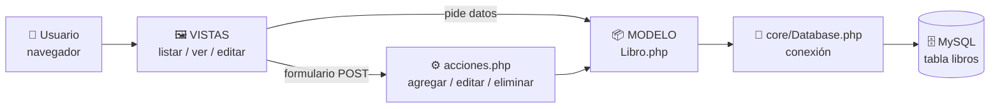
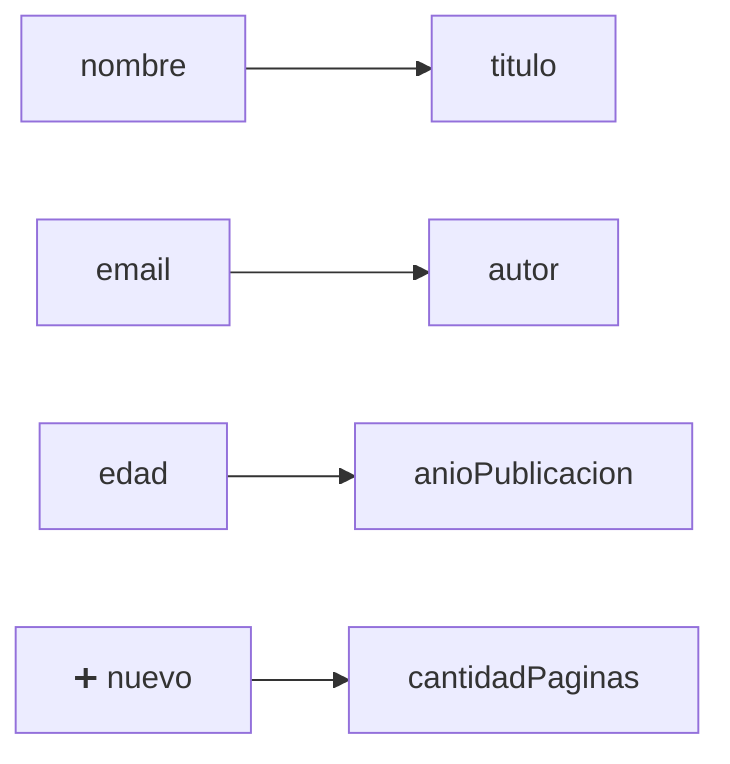
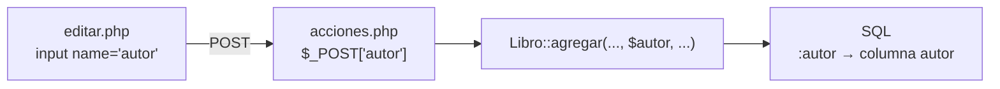
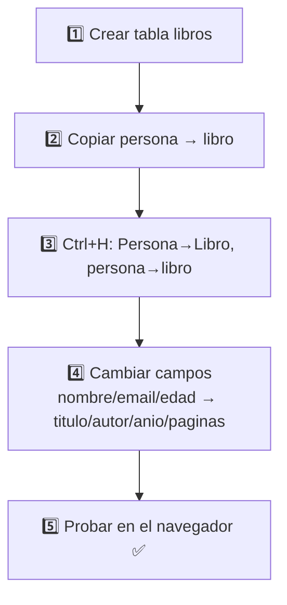

# 📚 Guía: CRUD de Libro (paso a paso)

> **Objetivo:** hacer un ABM (Alta, Baja, Modificación y Listado) de **Libro** usando la misma arquitectura que ya tiene **Persona**.
>
> **Idea clave:** ¡no hay que escribir todo de cero! Vamos a **copiar Persona** y **reemplazar** lo necesario. 🔁

**Clase:** `Libro`
**Propiedades:** `id`, `titulo`, `autor`, `anioPublicacion`, `cantidadPaginas`

---

## 🗺️ 1. ¿Cómo funciona la arquitectura?



| Capa | Archivo | ¿Qué hace? |
|------|---------|-----------|
| 🗄️ Base de datos | `db/schema.sql` | Crea la tabla |
| 🔌 Conexión | `core/Database.php` | **No se toca.** Ya está hecha |
| 📦 Modelo | `modelo/libro.php` | Habla con la BD (SELECT, INSERT, UPDATE, DELETE) |
| ⚙️ Acciones | `libro/acciones.php` | Recibe los formularios y llama al modelo |
| 🖼️ Vistas | `libro/vistas/*.php` | Lo que ve el usuario (HTML) |

---

## 📁 2. ¿Cómo tiene que quedar el proyecto?

```
arq-2026/
├── core/
│   └── Database.php        ← NO SE TOCA
├── db/
│   └── schema.sql          ← ✏️ agregar tabla libros
├── modelo/
│   ├── persona.php
│   └── libro.php           ← 🆕 copia de persona.php
├── persona/                ← ejemplo (no se toca)
└── libro/                  ← 🆕 copia de la carpeta persona
    ├── acciones.php
    └── vistas/
        ├── listar.php
        ├── ver.php
        └── editar.php
```

---

## ✅ Checklist rápido

- [ ] Paso 0: Pararse en la rama `feature/arq-con-db`
- [ ] Paso 1: Crear la tabla `libros`
- [ ] Paso 2: Copiar archivos
- [ ] Paso 3: Buscar y reemplazar nombres
- [ ] Paso 4: Cambiar los campos
- [ ] Paso 5: Probar

---

## 🌿 Paso 0 — Cambiar de rama

```bash
git checkout feature/arq-con-db
git pull
```

---

## 🗄️ Paso 1 — Crear la tabla

Agregar esto al final de `db/schema.sql` y ejecutarlo en **phpMyAdmin** (pestaña **SQL**):

```sql
CREATE TABLE IF NOT EXISTS libros (
    id INT AUTO_INCREMENT PRIMARY KEY,
    titulo VARCHAR(200) NOT NULL,
    autor VARCHAR(150) NOT NULL,
    anioPublicacion INT NOT NULL,
    cantidadPaginas INT NOT NULL
);

INSERT INTO libros (titulo, autor, anioPublicacion, cantidadPaginas) VALUES
('Cien años de soledad', 'Gabriel García Márquez', 1967, 417),
('El principito', 'Antoine de Saint-Exupéry', 1943, 96);
```

> ⚠️ **Importante:** las columnas se tienen que llamar **igual** que las propiedades de la clase (`anioPublicacion`, `cantidadPaginas`). Así PDO arma los objetos solo (`FETCH_CLASS`).

---

## 📋 Paso 2 — Copiar archivos

| Copiar... | ...y pegar como |
|-----------|-----------------|
| `modelo/persona.php` | `modelo/libro.php` |
| carpeta `persona/` completa | carpeta `libro/` |

---

## 🔁 Paso 3 — Buscar y reemplazar (la magia)

En VS Code: abrir cada archivo nuevo → **`Ctrl + H`** → activar **`Aa`** (distinguir mayúsculas) → **Reemplazar todo**.

Hacerlo en los **5 archivos nuevos** (`modelo/libro.php`, `libro/acciones.php`, `libro/vistas/listar.php`, `ver.php`, `editar.php`):

| 🔍 Buscar | ✏️ Reemplazar por |
|-----------|------------------|
| `Persona` | `Libro` |
| `persona` | `libro` |

> 💡 Con esos 2 reemplazos ya cambia todo: `personas` → `libros`, `Persona::` → `Libro::`, `modelo/persona.php` → `modelo/libro.php`, `$persona` → `$libro`, etc.

---

## ✏️ Paso 4 — Cambiar los campos

Persona tiene **3 campos** y Libro tiene **4**. Esta es la "traducción":



Ahora vamos archivo por archivo. **Solo hay que tocar las líneas marcadas.**

### 📦 4.1 `modelo/libro.php`

**a) Propiedades** (arriba de todo):

```php
public $id;
public $titulo;
public $autor;
public $anioPublicacion;
public $cantidadPaginas;
```

**b) En los 2 SELECT** (`obtenerTodas` y `obtenerPorId`) cambiar las columnas:

```php
// ANTES:  SELECT id, nombre, email, edad FROM libros ...
// AHORA:
SELECT id, titulo, autor, anioPublicacion, cantidadPaginas FROM libros ...
```

**c) En `agregar` y `editar`** seguir este patrón: donde decía `nombre, email, edad`, poner los 4 campos nuevos.

| Lugar | Antes | Ahora |
|-------|-------|-------|
| Parámetros de la función | `($nombre, $email, $edad)` | `($titulo, $autor, $anioPublicacion, $cantidadPaginas)` |
| INSERT columnas | `(nombre, email, edad)` | `(titulo, autor, anioPublicacion, cantidadPaginas)` |
| INSERT valores | `(:nombre, :email, :edad)` | `(:titulo, :autor, :anioPublicacion, :cantidadPaginas)` |
| UPDATE SET | `nombre = :nombre, email = :email, edad = :edad` | `titulo = :titulo, autor = :autor, anioPublicacion = :anioPublicacion, cantidadPaginas = :cantidadPaginas` |
| Array del `execute` | `':nombre' => $nombre, ...` | `':titulo' => $titulo, ':autor' => $autor, ':anioPublicacion' => $anioPublicacion, ':cantidadPaginas' => $cantidadPaginas` |

> 💡 En `editar` recordar que primero va el `$id`: `editar($id, $titulo, $autor, $anioPublicacion, $cantidadPaginas)`

`eliminar` **no se toca** (solo usa el `id`). 🎉

---

### ⚙️ 4.2 `libro/acciones.php`

**a) Leer los datos del formulario:**

```php
$titulo = $_POST['titulo'] ?? '';
$autor = $_POST['autor'] ?? '';
$anioPublicacion = $_POST['anioPublicacion'] ?? '';
$cantidadPaginas = $_POST['cantidadPaginas'] ?? '';
```

**b) Llamadas al modelo:**

```php
Libro::agregar($titulo, $autor, $anioPublicacion, $cantidadPaginas);
Libro::editar($id, $titulo, $autor, $anioPublicacion, $cantidadPaginas);
```

---

### 🖼️ 4.3 `libro/vistas/listar.php`

**a) Encabezados de la tabla** (`<th>`):

```html
<th>ID</th>
<th>Título</th>
<th>Autor</th>
<th>Año</th>
<th>Páginas</th>
<th>Acciones</th>
```

**b) Celdas** (`<td>`) — patrón: `$p->` + nombre de la propiedad:

```php
<td><?php echo $p->id; ?></td>
<td><?php echo $p->titulo; ?></td>
<td><?php echo $p->autor; ?></td>
<td><?php echo $p->anioPublicacion; ?></td>
<td><?php echo $p->cantidadPaginas; ?></td>
```

> 💡 (Opcional) Cambiar `$personas`/`$p` por `$libros`/`$l` si quieren que se lea mejor.

---

### 🖼️ 4.4 `libro/vistas/ver.php`

Cambiar los `<p>` del detalle:

```php
<p><strong>Título:</strong> <?php echo $libro->titulo; ?></p>
<p><strong>Autor:</strong> <?php echo $libro->autor; ?></p>
<p><strong>Año:</strong> <?php echo $libro->anioPublicacion; ?></p>
<p><strong>Páginas:</strong> <?php echo $libro->cantidadPaginas; ?></p>
```

---

### 🖼️ 4.5 `libro/vistas/editar.php`

Cada campo del formulario es un bloque así. **Copiar el bloque 4 veces** y cambiar las 3 partes marcadas:

```php
<div class="mb-3">
    <label class="form-label">Título</label>                         <!-- ① texto -->
    <input type="text" class="form-control" name="titulo"            <!-- ② tipo y name -->
           value="<?php echo $libro ? $libro->titulo : ''; ?>" required> <!-- ③ propiedad -->
</div>
```

| ① Label | ② `type` | ② `name` | ③ `$libro->...` |
|---------|----------|----------|-----------------|
| Título | `text` | `titulo` | `titulo` |
| Autor | `text` | `autor` | `autor` |
| Año de publicación | `number` | `anioPublicacion` | `anioPublicacion` |
| Cantidad de páginas | `number` | `cantidadPaginas` | `cantidadPaginas` |

> ⚠️ **Ojo:** este archivo ya usa una variable `$titulo` para el título de la página ("Agregar Libro" / "Editar Libro"). **No la borren.** No choca con `$libro->titulo` porque son cosas distintas.

> 🔗 **La regla de oro:** el `name="..."` del input tiene que ser **igual** a lo que lee `$_POST['...']` en `acciones.php`.



---

## 🧪 Paso 5 — Probar

Abrir en el navegador: **http://localhost/arq-2026/libro/vistas/listar.php**

| Prueba | ¿Qué debería pasar? |
|--------|---------------------|
| 📋 Abrir el listado | Se ven los 2 libros de ejemplo |
| ➕ Agregar | Aparece el nuevo libro en la lista |
| 👁️ Ver | Muestra el detalle |
| ✏️ Editar | Se guardan los cambios |
| 🗑️ Eliminar | Desaparece de la lista |

---

## 🆘 Errores comunes

| Síntoma | Causa probable | Solución |
|---------|----------------|----------|
| Pantalla en blanco / `Class "Persona" not found` | Quedó algún `Persona` sin reemplazar | Repetir el Paso 3 con `Aa` activado |
| `Failed to open stream ... libro.php` | Ruta del `require_once` mal escrita | Revisar que diga `modelo/libro.php` |
| `Table 'arq_2026.libros' doesn't exist` | No se ejecutó el SQL | Repetir el Paso 1 |
| `Unknown column 'nombre'` | Quedó un campo viejo en el SQL | Revisar los SELECT/INSERT/UPDATE del modelo |
| Se guarda vacío un campo | El `name` del input no coincide con `$_POST` | Aplicar la **regla de oro** 🔗 |
| La columna sale vacía en el listado | Propiedad mal escrita (`anioPublicación`, `aniopublicacion`) | Respetar mayúsculas y **sin tildes** |

---

## 🏁 Resumen en 1 imagen



¡Listo! 🎉 Con este mismo método pueden hacer el CRUD de **cualquier** entidad (Auto, Producto, Alumno...).
